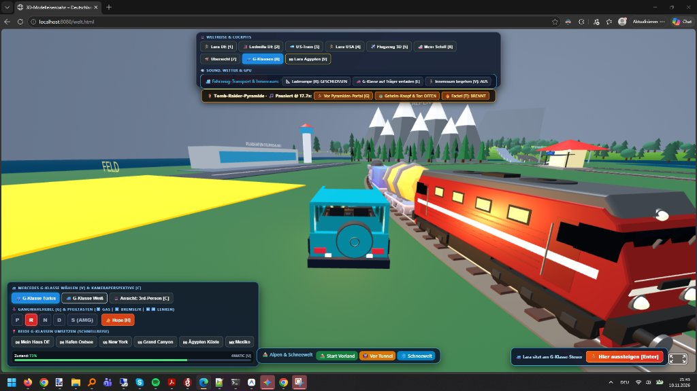
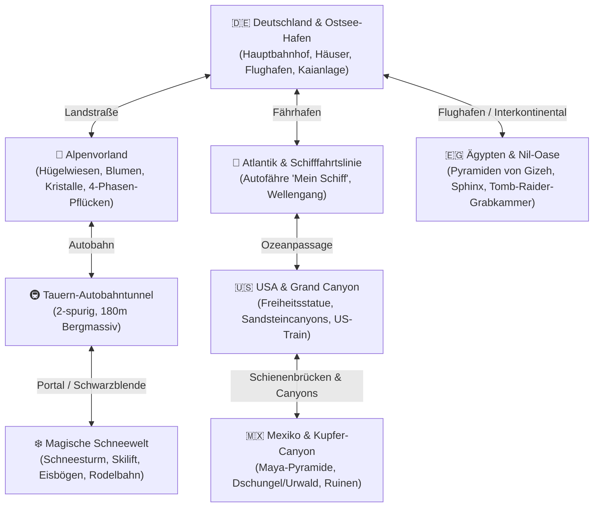
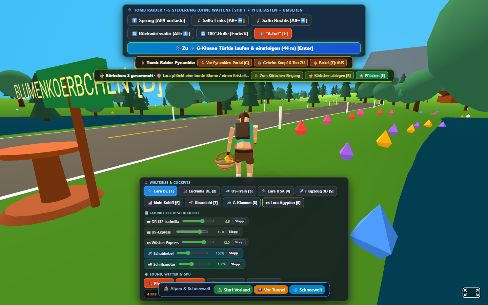
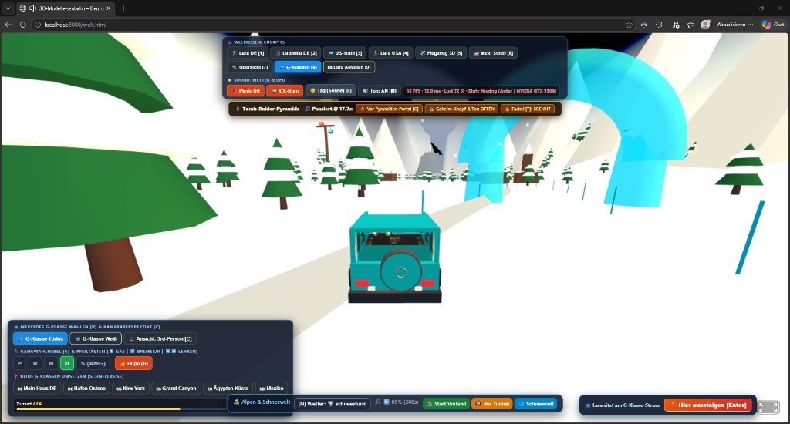
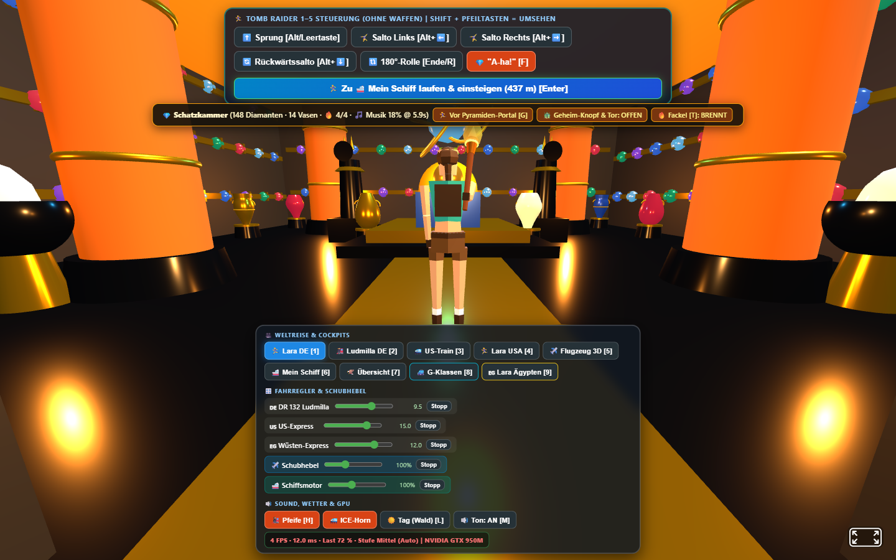
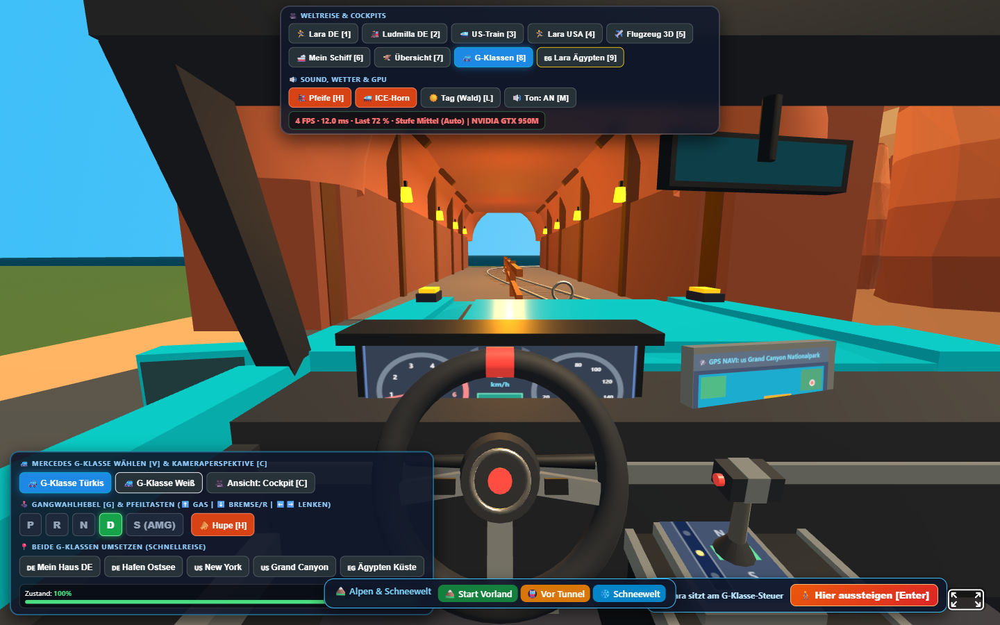
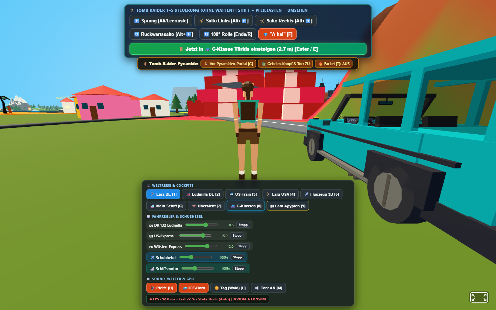
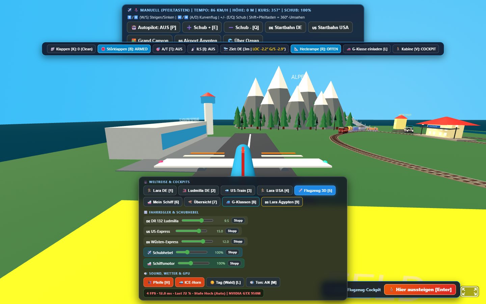
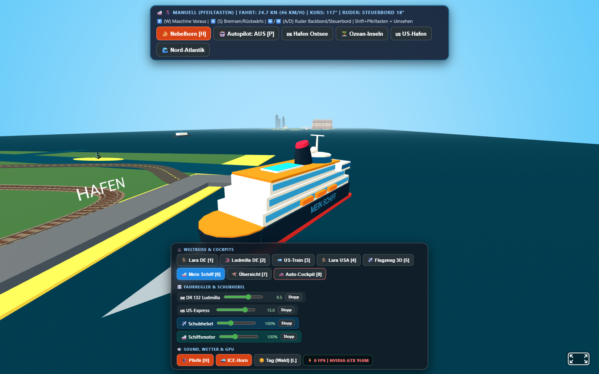

# 3D-Modelleisenbahn & Abenteuerwelt 🚂🌍✨

> **Interaktive 3D-Modellbahn- und Multiversum-Welt für Vater & Sohn im Browser (Three.js / A-Frame) – mit Dampfloks, ICE & Dieselloks, Mercedes G-Klassen, Frachtflugzeugen, Autofähren, Lara Croft und nahtlos verknüpften Kontinenten.**

[](https://microsoft.com)
[](https://threejs.org)
[](https://get.webgl.org/)
[](#architektur--modulstruktur-js)
[](#fachliche-spezifikationen--produktwissen-specsyaml)
[](#tests--automatisierte-qualitätssicherung)
[](https://antigravity.google)
[](#überblick--kernfeatures)

---

## Inhaltsverzeichnis

1. [Überblick & Kernfeatures](#überblick--kernfeatures)
2. [Die 6 Spielwelten & Kontinente](#die-6-spielwelten--kontinente)
3. [Fahrzeuge, Züge, Flugzeuge, Schiffe & Avatare](#fahrzeuge-züge-flugzeuge-schiffe--avatare)
4. [Interaktives Steuerpult & Cockpit-Referenz](#interaktives-steuerpult--cockpit-referenz)
5. [Systemvoraussetzungen & GPU-Optimierung](#systemvoraussetzungen--gpu-optimierung)
6. [Schnellstart & Lokaler Webserver](#schnellstart--lokaler-webserver)
7. [All-in-One KI-Start-Prompt (Copy & Paste)](#all-in-one-ki-start-prompt-copy--paste)
8. [Architektur & Modulstruktur (`js/*`)](#architektur--modulstruktur-js)
9. [Fachliche Spezifikationen & Produktwissen (`specs/*.yaml`)](#fachliche-spezifikationen--produktwissen-specsyaml)
10. [Tests & Automatisierte Qualitätssicherung](#tests--automatisierte-qualitätssicherung)
11. [Verzeichnisstruktur & Wichtige Dateien](#verzeichnisstruktur--wichtige-dateien)

---

## Überblick & Kernfeatures

Die **3D-Modelleisenbahn & Abenteuerwelt** verwirklicht den Traum einer riesigen Modelleisenbahn-Platte im klassischen *„EEP-Vibe“* – erweitert um eine zusammenhängende, physikalisch simulierte Welt aus mehreren Kontinenten, Fahrzeugen und Abenteuern:

* **Echtes Modelleisenbahn-Gefühl:** BR 132 *„Ludmilla“* mit Kesselwagen, sächsische Schmalspurbahn *VI K 99 646*, moderner US-Train und ICE auf einem weitverzweigten Schienennetz mit Weichen, Schwellen und Blocksignalen.
* **Multimodale Freiheit:** Steige nahtlos aus dem Zug in eine **Mercedes G-Klasse** (türkis oder weiß) um, fliege ein Frachtflugzeug von der Startbahn über die Berge oder steuere die Autofähre *„Mein Schiff“* über den Atlantik.
* **Funktionaler Fahrzeugtransport:** Fahre mit der G-Klasse über bewegliche Auffahrrampen auf die Flachwagen des Güterzuges oder auf das Autodeck des Schiffes, sichere das Fahrzeug und fahre als Passagier mit.
* **Erkundung mit Lara Croft:** Begehe die Welt zu Fuß in der 3rd-Person-Perspektive – klettere auf Pyramiden, entzünde Fackeln in Tempelgewölben oder nimm ein Weidenkörbchen, um Blumen und Kristalle im Alpenvorland zu sammeln.
* **Stimmungsvolle Klang- & Wetterkulisse:** Authentische WebAudio-Synthesizer (Dampflok-Pfeife, Dieselbrummen, Horn) kombiniert mit stimmungsvoller YouTube-Hintergrundmusik, Tag/Nacht-Lichtwechsel und dynamischem Wetter (Sonnenschein, Regen, Schnee und Schneesturm).
* **100 % kinderfreundlich & waffenfrei:** Keine Gewalt, keine Waffen – pure Freude am Bauen, Fahren, Entdecken und Experimentieren.



---

## Die 6 Spielwelten & Kontinente

Alle Regionen sind über Straßen, Schienenstrecken, Tunnel, Seewege oder Flugrouten nahtlos miteinander verbunden oder per Schnellreise-HUD in Sekunden erreichbar:



### 1. Deutschland & Alpenvorland
* **Hauptbahnhof & Stadt:** Weitläufiges Gleisnetz mit Schotterbett, Weichen, Bahnsteigen, Straßennetz, Fachwerkhäusern, Bäumen und einem belebten Flughafen mit Tower und Landebahn.
* **Blumenwiese & Körbchen:** Sanfte grüne Hügel mit über 700 bunten Blumen und funkelnden Kristallen. Am Tunneleingang steht ein Weidenkörbchen bereit, das Lara Croft aufnehmen kann. Beim Pflücken führt sie eine flüssige 4-Phasen-Bewegung aus; die gepflückten Schätze bleiben aufrecht im Korb sichtbar.



### 2. Tauern-Tunnel & Magische Schneewelt
* **Der Tauern-Autobahntunnel:** Ein 180 Meter langer, beleuchteter Doppelröhren-Tunnel bohrt sich durch das massive Hochgebirge.
* **Die Winterwelt:** Am Ende des Tunnels führt eine atmosphärische Schwarzblende in ein hochalpines Schneetal mit dichtem Schneefall, mächtigen Eisbögen, Skilift-Gondeln, Rodelhang und Orchesterklängen.



### 3. Ägypten & Pyramiden von Gizeh
* **Wüsten-Biom:** Riesige Dünen, Oasen mit Palmen, der Nil und die monumentalen Bauwerke der Antike: Große Pyramiden und die Sphinx.
* **Geheime Grabkammer:** Eine interaktive Tempelanlage im *Tomb-Raider*-Stil. Durch Druck auf einen verborgenen Skarabäus-Schalter öffnet sich das schwere Steintor; Fackeln mit dynamischem Flammenschein erhellen den Raum, während antike Orchestermusik sanft eingeblendet wird.



### 4. USA & Grand Canyon
* **Küstenmetropole & Freiheitsstatue:** New Yorker Hafenbecken und Skyline.
* **Canyon-Schlucht:** Spektakuläre Felswände aus rotem Sandstein, gewaltige Schienenviadukte, Colorado-River und ein mächtiger Eisenbahntunnel für den schweren US-Güterzug.



### 5. Mexiko & Kupfer-Canyon
* **Maya-Kultur & Dschungel:** Dichte Urwälder, Azteken-Ruinen, Hängebrücken und eine monumentale Stufenpyramide im mexikanischen Hochland.
* **Kupferberg:** Gewaltige Bergflanken mit anspruchsvollen Serpentinen für die Geländewagen.



---

## Fahrzeuge, Züge, Flugzeuge, Schiffe & Avatare

### 1. Züge & Rollmaterial
* **BR 132 „Ludmilla“:** Legendäre Großdiesellokomotive der Deutschen Reichsbahn mit sattem Motorsound, Spitzenlicht und schweren Kesselwagen.
* **Sächsische VI K 99 646:** Originalgetreues Schmalspurmodell mit detaillierten Einheitswagen.
* **US-Streamliner / Güterzug:** Schwere amerikanische Lokomotive für lange Transkontinentalstrecken.
* **Dynamische Steuerung:** Stufenlose Beschleunigung, Richtungswechsel, Weichenschaltung per Klick und WebAudio-Pfeifen.

### 2. Mercedes-Benz G-Klasse (Türkis & Weiß)
* **Fahrphysik:** Realistischer 4MATIC-Allradantrieb, gefederte Radaufhängung, Neigung in Kurven, Driftverhalten und Geländegängigkeit.
* **Gangwahlhebel:** Vollwertige Automatik mit Stufen **P** (Parken), **R** (Rückwärts), **N** (Leerlauf), **D** (Drive) und **S** (AMG Sportmodus mit doppelter Beschleunigung).
* **Ausstattung:** Funktionierende Frontscheinwerfer, Hupe `[H]`, Cockpit- und Verfolgerperspektive `[C]`.

### 3. Frachtflugzeug & Luftfahrtphysik (`js/physik/flug-physik.js`)
* **Aerodynamik:** Physikalischer Auftrieb, induzierter Widerstand, Stall (Strömungsabriss) und Overspeed-Grenzwerte.
* **Avionik:** 4-stufige Landeklappen (`Flaps 0/1/2/FULL`), Störklappen (`Spoilers`), Autothrottle, Schubumkehr und 3°-ILS-Gleitpfadanflug auf den Flughafen.



### 4. Autofähre „Mein Schiff“ & Seefahrt
* **Nautik:** Träges Wende- und Bremsverhalten auf offenem Meer, physikalischer Wellengang mit Stampf- und Rollbewegungen.
* **Fahrzeugtransport:** Über die Taste `[L]` öffnet sich die Heckladerampe. G-Klassen können an Bord gefahren, geparkt und über das Meer transportiert werden.



### 5. Lara Croft Avatar
* **Freie Fortbewegung:** Flüssige 3rd-Person-Steuerung zu Fuß: Gehen, Sprinten, Springen und Klettern.
* **Interaktion:** Fackel mit dynamischem Flammenschein tragen, Geheimknöpfe aktivieren, Fahrzeuge besteigen und Blumenkörbchen tragen.

---

## Interaktives Steuerpult & Cockpit-Referenz

### Schnellwahltasten (Weltreise & Cockpits)
| Taste | Ansicht / Funktion |
| :---: | :--- |
| `[1]` | **Lara Croft (Deutschland)** – Zu Fuß am Hauptbahnhof |
| `[2]` | **Führerstand Ludmilla** – Mitfahrt auf der Großdiesellok |
| `[3]` | **Führerstand US-Train** – Fahrt durch die Canyons |
| `[4]` | **Lara Croft (USA)** – Zu Fuß in New York |
| `[5]` | **Flugzeug 3D** – Cockpit & Flugsteuerung |
| `[6]` | **Mein Schiff** – Schiffsbrücke & Seefahrt |
| `[7]` | **Helikopter / Vogelperspektive** – Freie Übersicht über die Modellbahnplatte |
| `[8]` | **Mercedes G-Klassen** – Cockpit & Steuer des Geländewagens |
| `[9]` | **Lara Croft (Ägypten)** – Vor den Toren der Pyramide |

### Fahrzeug- & Bewegungssteuerung
* **Mercedes G-Klasse:**
  * `[W]` / `[↑]` Gas geben &nbsp;|&nbsp; `[S]` / `[↓]` Bremsen & Rückwärts &nbsp;|&nbsp; `[A]`/`[D]` bzw. `[←]`/`[→]` Lenken
  * `[G]` Gangwahl (P / R / N / D / S AMG) &nbsp;|&nbsp; `[H]` Hupe &nbsp;|&nbsp; `[C]` Kamera Cockpit/Verfolger &nbsp;|&nbsp; `[V]` Fahrzeug wechseln (Türkis ↔ Weiß)
  * `[Enter]` Einsteigen / Aussteigen (zu Lara Croft) &nbsp;|&nbsp; `[L]` Laderampe heben/senken
* **Lara Croft zu Fuß:**
  * `WASD` / `Pfeiltasten` Laufen &nbsp;|&nbsp; `Umschalttaste (Shift)` Sprinten &nbsp;|&nbsp; `Leertaste` Springen
  * `[B]` Weidenkörbchen aufnehmen / auf Podest abstellen
  * `[E]` oder `[P]` Nächste Blume/Kristall pflücken
  * `[T]` Fackel entzünden / löschen
* **Züge & Lokomotiven:**
  * `[W]` / `[S]` Fahrregler schneller / langsamer &nbsp;|&nbsp; `Leertaste` Notbremse &nbsp;|&nbsp; `[H]` Pfeife / Lokhorn
* **Umwelt & System:**
  * `[L]` Lichtstimmung umschalten (Tagessonne, Abendrot, Nacht mit Laternen & leuchtenden Zugfenstern)
  * `[N]` Dynamischer Wetterzyklus (Sonne, Regen, Schnee, Schneesturm)
  * `[M]` Audio stummschalten (Mute) &nbsp;|&nbsp; `[F]` Vollbildmodus

---

## Systemvoraussetzungen & GPU-Optimierung

* **Betriebssystem:** Windows 10 oder Windows 11 (empfohlen für GPU-Hardware-Beschleunigung).
* **Browser:** Microsoft Edge, Google Chrome, Brave oder Firefox mit aktiviertem **WebGL 2.0**.
* **Grafikkarte:** Dedizierte GPU (z. B. Nvidia GeForce GTX 950M oder besser) für stabile 60 FPS mit weichen Schatten (`pcfsoft`) und PBR-Materialien.
* **Automatisches Performance-LOD (`js/core/perf-lod.js`):** Ein integrierter Frame-Pacing-Wächter misst kontinuierlich die Bildwiederholrate. Sinkt die Performance unter 30 FPS, drosselt das System automatisch Schattenauflösung und Fernsicht (`Stufe Hoch → Mittel → Niedrig`), um Ruckler zu vermeiden.

---

## Schnellstart & Lokaler Webserver

Da moderne Browser aus Sicherheitsgründen das Laden lokaler 3D-Modelle (`.glb`) und Audio-Dateien über das `file://`-Protokoll blockieren (CORS), wird ein kleiner lokaler HTTP-Server benötigt:

### 1. Repository klonen
```powershell
git clone https://github.com/OneWorld123/father-son-model-world.git M:\Develop\Trains
cd M:\Develop\Trains
```

### 2. Lokalen Server starten (PowerShell)
```powershell
# Startet den integrierten, autarken PowerShell-HTTP-Server auf Port 8080:
$l = New-Object System.Net.HttpListener; $l.Prefixes.Add('http://localhost:8080/'); $l.Start(); Write-Host 'HTTP_SERVER_STARTED_8080'; while ($l.IsListening) { $ctx = $l.GetContext(); $rel = $ctx.Request.Url.LocalPath.TrimStart('/'); if (-not $rel) { $rel = 'welt.html' }; $p = Join-Path 'M:\Develop\Trains' ([uri]::UnescapeDataString($rel)); if (Test-Path $p -PathType Leaf) { $b = [System.IO.File]::ReadAllBytes($p); $ext = [System.IO.Path]::GetExtension($p).ToLower(); $ct = switch ($ext) { '.html' {'text/html; charset=utf-8'} '.js' {'application/javascript; charset=utf-8'} '.glb' {'model/gltf-binary'} '.png' {'image/png'} '.jpg' {'image/jpeg'} default {'application/octet-stream'} }; $ctx.Response.ContentType = $ct; $ctx.Response.ContentLength64 = $b.Length; $ctx.Response.OutputStream.Write($b, 0, $b.Length) } else { $ctx.Response.StatusCode = 404 }; $ctx.Response.Close() }
```

### 3. Im Browser öffnen
Öffne einfach: **[http://localhost:8080/welt.html](http://localhost:8080/welt.html)**

---

## All-in-One KI-Start-Prompt (Copy & Paste)

Kopiere bei einem neu geöffneten Workspace oder Agenten-Chat einfach diesen Text:

```markdown
Ich arbeite an der 3D-Modelleisenbahn & Abenteuerwelt (father-son-model-world). Lies bitte zuerst `.agents/rules/eep.md` und `README.md`.
Führe anschließend folgende Prüfungen durch:
1. Validiere alle Spezifikationen mit: powershell -ExecutionPolicy Bypass -File .\validate_specs.ps1
2. Prüfe die modulare Architektur (< 800 Zeilen pro Datei) mit: powershell -ExecutionPolicy Bypass -File .\test_auto.ps1 -Query "archtest=1" -WaitSeconds 6
3. Überprüfe, ob der lokale Webserver auf Port 8080 aktiv ist.
4. Gib mir einen kurzen Überblick über den Projektstatus und warte auf meine nächste Bauanweisung!
```

---

## Architektur & Modulstruktur (`js/*`)

Um maximale Performance, deterministische Testbarkeit und Wartbarkeit zu garantieren, folgt das Projekt strengen Architekturvorgaben (`s-architecture-lod-001`):

```mermaid
graph TD
    subgraph View & DOM Schicht [View-Schicht in welt.html]
        AFrameScene["A-Frame Szene &lt;a-scene&gt;"]
        BaukastenOld["baukasten.js (Zug/Gleise - EINGEFROREN)"]
        UIBridge["js/core/* (UI & 3D-Bridges: Korb, Tunnel, Pyramide, Schnee, Flug)"]
    end

    subgraph Eventbus & Simulation [Zentraler Eventbus]
        EEPBus["EEP.bus (Entkoppelte Events: tunnel-uebergang, transport, schaden)"]
    end

    subgraph Reine Domänenlogik [js/welt/* & js/physik/* (0 DOM / 0 Three.js)]
        WeltKarte["js/welt/welt-karte.js (Höhenfelder & Zonen)"]
        Vorland["js/welt/alpenvorland.js (Topographie & Korb-Posen)"]
        SchneeWelt["js/welt/schneewelt.js (Schneetal & Wetterzustände)"]
        PyramideKammer["js/welt/pyramiden-kammer.js (Tempel & Skarabäus)"]
        TransportLogik["js/welt/fahrzeug-transport.js (Rampen & Beladung)"]
        FahrPhysik["js/physik/fahrzeug-physik.js (4MATIC & Reifen)"]
        FlugPhysik["js/physik/flug-physik.js (Auftrieb, Flaps, ILS)"]
        Kollision["js/physik/kollision.js (8m Spatial Hash)"]
        Schaden["js/physik/schaden.js (Sink- & Wasserphysik)"]
    end

    AFrameScene --> BaukastenOld
    AFrameScene --> UIBridge
    UIBridge <--> EEPBus
    EEPBus <--> Reine Domänenlogik
```

### Strikte Architektur-Regeln
1. **`< 800` Zeilen pro Datei:** Keine Datei unter `js/` darf 800 Zeilen überschreiten (automatisch überwacht durch `t-architecture-lod-001`).
2. **Reine Simulationslogik:** Alle Module unter `js/welt/` und `js/physik/` enthalten **weder `THREE.` noch `AFRAME` noch `document.`-Aufrufe**. Sie arbeiten mit flachen Skalaren und deterministischer Mathematik und können komplett ohne Browser/DOM getestet werden.
3. **`baukasten.js` ist eingefroren:** Neue Features werden als unabhängige Module unter `js/core/` (für View/HUD) bzw. `js/welt/` (für Logik) ergänzt.

---

## Fachliche Spezifikationen & Produktwissen (`specs/*.yaml`)

Das Repository arbeitet streng nach dem **Spec-First-Prinzip** (dokumentiert in [`docs/specs-decisions-tests.md`](docs/specs-decisions-tests.md)). Alle Anforderungen sind als maschinenlesbare YAML-Spezifikationen formal hinterlegt:

| Bereichsdatei | Inhalt & Spezifikationsfokus |
| :--- | :--- |
| **[`specs/afrika-aegypten.yaml`](specs/afrika-aegypten.yaml)** | Pyramiden von Gizeh, Sphinx, Oase, Nil und Tempelanlagen |
| **[`specs/alpine-foreland-tunnel.yaml`](specs/alpine-foreland-tunnel.yaml)** | Alpenvorland, 704 Blumen/Kristalle, Korb-Pflückmechanik, Tauern-Tunnel |
| **[`specs/architecture-lod.yaml`](specs/architecture-lod.yaml)** | Modulare JS-Architektur (< 800 Zeilen), Eventbus, adaptives Performance-LOD |
| **[`specs/car-cockpit.yaml`](specs/car-cockpit.yaml)** | Mercedes G-Klasse (4MATIC, Gangwahlhebel P/R/N/D/S, Drift, Cockpit-HUD) |
| **[`specs/damage-sinking.yaml`](specs/damage-sinking.yaml)** | Kollisionsschaden, Wasserlandung, Sinkverhalten und Fahrzeugbergung |
| **[`specs/flight-physics.yaml`](specs/flight-physics.yaml)** | Aerodynamischer Auftrieb, Landeklappen 0-FULL, Stall, ILS Localizer/Glide |
| **[`specs/grand-canyon-tunnel.yaml`](specs/grand-canyon-tunnel.yaml)** | Canyonschluchten, Colorado River, Schienenviadukte und Tunnelportal |
| **[`specs/lara-croft.yaml`](specs/lara-croft.yaml)** | 3rd-Person-Steuerung, Klettern, Fackel, 100% waffenfreies Gameplay |
| **[`specs/mexico-world.yaml`](specs/mexico-world.yaml)** | Maya-Pyramide, Kupfer-Canyon, dichter Dschungel und Azteken-Ruinen |
| **[`specs/pyramid-chamber.yaml`](specs/pyramid-chamber.yaml)** | Tomb-Raider-Schatzkammer, Skarabäus-Schalter, Steintor, Tempelmusik |
| **[`specs/ship-airplane-controls.yaml`](specs/ship-airplane-controls.yaml)** | Steuerbare Autofähre (Mein Schiff), Ruder/Schraube, Flughafen & Runway |
| **[`specs/snow-world.yaml`](specs/snow-world.yaml)** | Magische Schneewelt, Winterwetter, Skilift, Eisbögen und Schwarzblende |
| **[`specs/vehicle-transport.yaml`](specs/vehicle-transport.yaml)** | Autoverladung auf Flachwagen & Fähre via Laderampen, Innenraum-Begehung |
| **[`specs/world-collisions.yaml`](specs/world-collisions.yaml)** | 8m Spatial Hash Kollisionsgitter und kontinuierliche Geländehöhen |

---

## Tests & Automatisierte Qualitätssicherung

Die Codebasis verfügt über eine automatisierte, zweistufige Testpipeline:

```powershell
# 1. Formale Spezifikationsprüfung (Syntax, Schemata, IDs, Konsistenz):
powershell -ExecutionPolicy Bypass -File .\validate_specs.ps1

# 2. Architekturprüfung (Einhaltung der < 800 Zeilen-Grenze & Modulregistry):
powershell -ExecutionPolicy Bypass -File .\test_auto.ps1 -Query "archtest=1" -WaitSeconds 6

# 3. Alpenvorland- & Blumenpflücktest (Korb-Ausrichtung & Pflückstatus):
powershell -ExecutionPolicy Bypass -File .\test_auto.ps1 -Query "vorlandtest=1" -WaitSeconds 8

# 4. G-Klasse Cockpit- & Fahrphysiktest:
powershell -ExecutionPolicy Bypass -File .\test_auto.ps1 -Query "cam=3" -WaitSeconds 8
```

---

## Verzeichnisstruktur & Wichtige Dateien

| Datei / Verzeichnis | Zweck & Beschreibung |
| :--- | :--- |
| **[`welt.html`](welt.html)** | **Haupt-Szene:** Die lebendige 3D-Modellbahn- und Abenteuer-Welt. |
| **[`README.md`](README.md)** | Dieses Dokument (Projektübersicht, Schnellstart, Steuerung, Architektur). |
| **[`.agents/rules/eep.md`](.agents/rules/eep.md)** | Verbindliche Entwicklungs- und Architekturregeln für alle KI-Agenten. |
| **[`validate_specs.ps1`](validate_specs.ps1)** | Automatischer Validierer für alle 14 Spezifikationsdateien unter `specs/`. |
| **[`test_auto.ps1`](test_auto.ps1)** | Headless-Edge Testrunner mit echtem WebGL, GPU-Logs und Screenshot-Erzeugung. |
| **[`baukasten.js`](baukasten.js)** | A-Frame Kernkomponenten für Gleise, Züge und Landschaft (eingefroren). |
| **[`js/core/`](js/core/)** | View- und HUD-Brücken (`alpenvorland-ui`, `schneewelt-ui`, `pyramiden-ui`, `flug-transport-ui`, `perf-lod`). |
| **[`js/welt/`](js/welt/)** | Reine Domänenlogik (`alpenvorland`, `schneewelt`, `mexiko`, `pyramiden-kammer`, `fahrzeug-transport`, `welt-karte`). |
| **[`js/physik/`](js/physik/)** | Reine Physik-Engines (`fahrzeug-physik`, `flug-physik`, `kollision`, `schaden`). |
| **[`specs/`](specs/)** | Formale Spezifikationen (14 Dateien, 72 Specs, 38 Decisions, 27 Tests). |
| **[`docs/`](docs/)** | Ausführliche Dokumentation ([`specs-decisions-tests.md`](docs/specs-decisions-tests.md)) und Bildmaterial ([`docs/screenshots/`](docs/screenshots/)). |
| **[`models/`](models/)** | 3D-GLTF-Modelle (Kenney Train Kit, City Kit, Sächsische Schmalspurmodelle). |
| **[`sounds/`](sounds/)** | Audio-Dateien und Klangeffekte für Lokomotiven, Glocken und Umwelt. |

---

*Erstellt mit ❤️ für generationenübergreifenden Modellbahn- und Abenteuerspaß von Vater & Sohn.*
